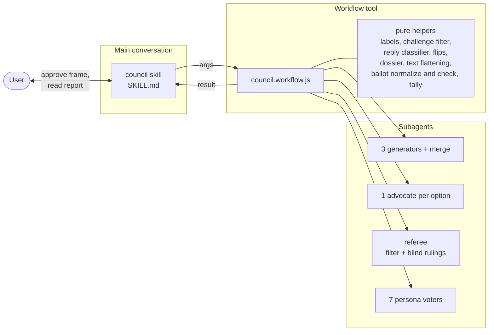
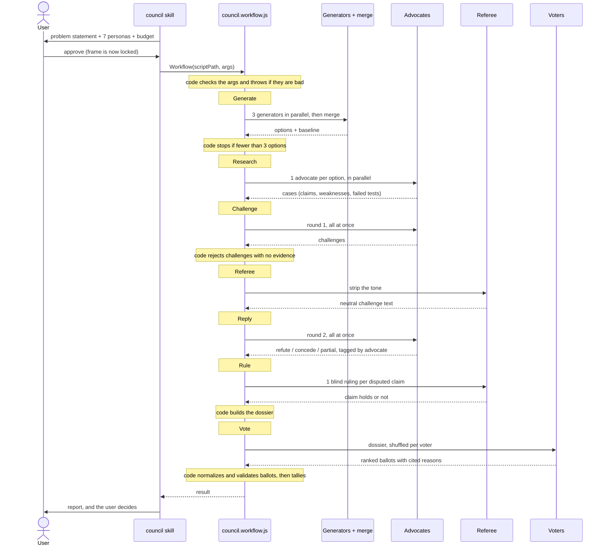
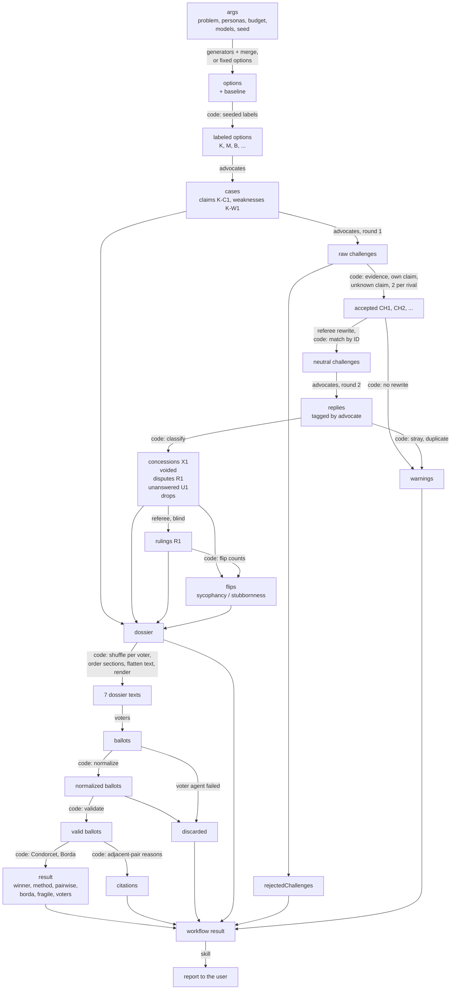

# Council Mode architecture

Council Mode has 2 parts. The `council` skill runs inside the main conversation, because step 1 and step 8 need the user. The Workflow script `council.workflow.js` runs steps 2–7 as a deterministic program that starts subagents and computes everything that does not need judgment.

## Components

| Part | Runs on | Does |
| --- | --- | --- |
| `SKILL.md` | Main agent | Checks fit, freezes the problem and panel with the user, starts the workflow, writes the report, groups similar flip conditions and hybrids |
| Orchestration body | Workflow runtime | Checks the arguments, calls agents in the right order, with barriers only where a stage needs every result of the stage before, and stops the run when an agent fails |
| Pure helpers | Workflow runtime | Every rule that code can enforce: seeded labels and order, evidence checks, classification, flip warnings, dossier, text flattening, ballot cleanup and validity, tally |
| Agents | Subagents | Only the work that needs judgment: options, research, challenges, rewrites, replies, rulings, ballots |

## A run, in order

If any agent in Generate through Rule fails, the run stops and returns a `stopped` reason. The skill then offers to resume the run.

## How data flows

Boxes are data. Arrows name the step that turns one into the next. `code` marks a step with no agent.

Notes on the steps:

- **Flatten text.** `oneLine` turns every piece of model-written text into one line before it goes into a prompt or the dossier. A model cannot add a fake heading, claim, or ruling with a line break.
- **Match replies.** Each advocate's replies stay tagged with its option label. A reply counts only if it answers a challenge against that option. Code ignores a stray reply (a challenge against another option, or an unknown ID) and a second reply to the same challenge. Both kinds are counted in `warnings`.
- **Match rewrites.** `applyRewrites` matches the referee's rewrites to challenges by ID, after trimming and uppercasing. A challenge with no usable rewrite keeps its original text, and its ID goes in `warnings`.
- **Confidence drops.** Every reply gives `newConfidence` and `dropReason`. A drop with an empty `dropReason` is recorded in `drops`.
- **Order per voter.** Each voter gets its own option order. Options appear in that order, and so do the entries of every evidence section (`byOrder`).
- **Normalize, then validate.** `normalizeBallot` turns "Option K" and "k" into "K", pulls valid dossier IDs out of each `cites` entry, and drops unknown labels from `unacceptable`. Then `validateBallot` checks the ballot. Only real defects discard a ballot.
- **Count citations.** `citationCounts` counts only reasons for adjacent pairs in the voter's own ranking. Each voter counts at most once per ID.

## IDs

Every item a voter can cite has an ID. Option labels are random letters that avoid the prefixes below.

| ID | Item | Made by |
| --- | --- | --- |
| `K-C1` | Claim 1 of Option K | `numberCase` |
| `K-W1` | Weakness 1 of Option K | `numberCase` |
| `CH1` | Accepted challenge 1 | `collectChallenges` |
| `X1` | Concession with evidence | `classifyReplies` |
| `R1` | Disputed claim and its ruling | `classifyReplies`, then the referee |
| `U1` | Unanswered challenge | `classifyReplies` |

A ballot reason must cite at least one claim, weakness, ruling, concession, or unanswered ID. A bare option label does not count. `CH1` IDs are internal: voters cannot cite them.

## Workflow arguments

| Argument | Required | Meaning |
| --- | --- | --- |
| `problem` | yes | The frozen problem statement |
| `personas` | yes | Exactly 7 `{ name, criteria, model }`, with different names |
| `budget` | no | Research budget text; default "at most 20 tool calls" |
| `advocateModel` | no | Model for advocates; default is the session model |
| `refereeModel` | yes | Model for the referee; must differ from `advocateModel` |
| `seed` | no | Integer for labels and voter order; default 1 |
| `isolateAdvocates` | no | `true` runs research agents in git worktrees |
| `thresholds` | no | `{ sycophancy }`; default 0.75 |
| `options`, `baseline` | no | Fixed options that skip Generate, for a hybrid round. Each is a string or `{ description }`. The default baseline is "Change nothing." |

The script throws, before it starts any agent, if `problem` is missing, there are not exactly 7 personas, `refereeModel` is missing, `refereeModel` equals `advocateModel`, 2 personas have the same name, or a fixed option or baseline has no description.

## Workflow result

| Field | Holds |
| --- | --- |
| `stopped` | Present only when the run stops early. The reasons are: fewer than 3 options, too many options, every ballot discarded, or a failed agent. A failed agent means all 3 generators, the merge, an advocate, a challenge agent, the referee filter, a reply agent, or a ruling. A failed-agent reason ends with "resume the run to retry it". A stopped result also holds the fields that exist at that point, such as `options` |
| `warnings` | Problems that did not stop the run: challenges the referee did not rewrite, and stray or duplicate replies |
| `options` | Labeled options, with the `baseline` flag |
| `dossier` | Everything voters saw: the problem, claims with status, rulings, concessions, voided concessions, unanswered challenges, unexplained confidence drops, flip counts |
| `rejectedChallenges` | Challenges stopped before delivery, with the reason: unknown claim, own claim, no evidence, or over limit |
| `result` | `method` (condorcet, borda, tie), `winner`, `tied`, `pairwise`, `borda`, `fragile`, `unacceptableVotes`, `voters` |
| `citations` | Dossier IDs with the number of voters who cited each, most cited first |
| `ballots` | Valid, normalized ballots: persona, model, ranking, reasons, flip condition, unacceptable marks, hybrid |
| `discarded` | Discarded ballots and their problems, including voters whose agent failed |

## Where each rule lives

| Spec rule | Enforced by |
| --- | --- |
| Challenges must cite evidence | `collectChallenges` (code) |
| At most 2 challenges per rival | `collectChallenges` (code) |
| Strip the tone | Referee filter agent; `applyRewrites` keeps the evidence unchanged |
| Hide identities | Prompts: replies and ballots never show who wrote a challenge or which model an advocate uses; the referee filter removes references to the author |
| Model text cannot forge structure | `oneLine` flattens text in prompts and the dossier (code) |
| Replies answer only own challenges | `classifyReplies` ignores stray and duplicate replies (code) |
| Concessions must cite evidence | `classifyReplies` voids them (code) |
| Confidence drops need evidence | `classifyReplies` records drops with no `dropReason` (code) |
| Answer every challenge | `classifyReplies` records unanswered challenges (code) |
| Rulings are binding | `buildDossier` marks the claim struck (code) |
| Simultaneous rounds | `parallel()` with one call per advocate per round |
| Blind referee | `rulingPrompt` shows no claim ID or option label |
| Neutral labels, shuffled order | `assignLabels`, `shuffle` with `seed`, `byOrder` (code) |
| Reasons must cite evidence | `normalizeBallot` cleans labels and IDs, then `validateBallot` checks them (code) |
| A failed agent never skews the dossier | The run stops with "resume the run to retry it" (code) |
| Condorcet, then Borda, then tie | `tally` (code) |
