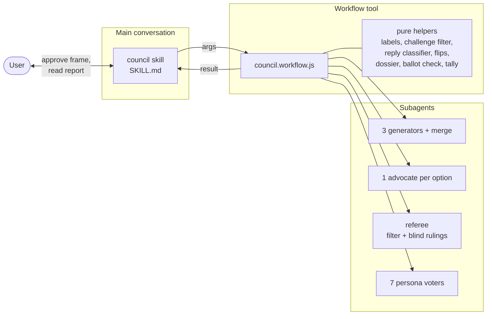
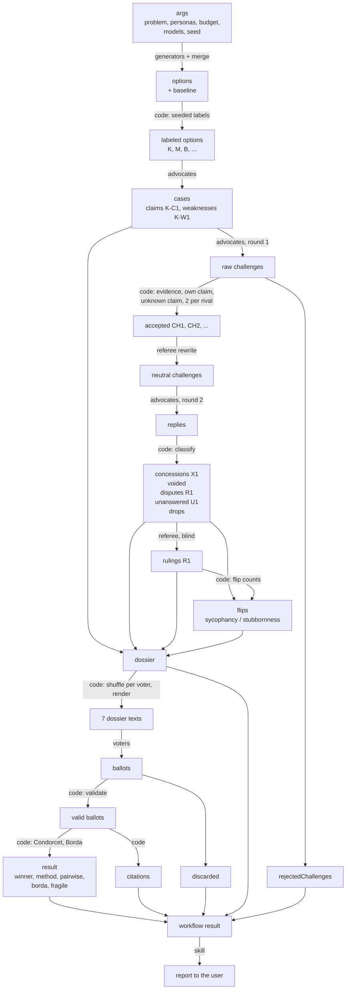

# Council Mode Implementation Plan

> **For agentic workers:** REQUIRED SUB-SKILL: Use superpowers:subagent-driven-development (recommended) or superpowers:executing-plans to implement this plan task-by-task. Steps use checkbox (`- [ ]`) syntax for tracking.

**Goal:** Build the `council-mode` Claude Code plugin: a `/council-mode:council` skill that freezes a problem and a 7-persona panel with the user, then runs a Workflow script in which advocates argue options with evidence, debate under a blind referee, and the panel ranks the options.

**Architecture:** One repo that is its own marketplace. The plugin holds one skill directory with `SKILL.md` and `council.workflow.js`. The workflow script has 2 parts: a "pure helpers" section (seeded randomness, challenge filtering, reply classification, flip counts, dossier, ballot validation, tally, prompts, schemas) and an orchestration body that calls `agent()`/`parallel()`. Node tests load the helpers section directly, and run the whole body against a fake council of canned agents.

**Tech Stack:** Plain JavaScript (Workflow scripts cannot use TypeScript or imports), Node 22 built-in test runner (`node --test`), Claude Code plugin format.

**Spec:** `docs/superpowers/specs/2026-11-11-council-mode-design.md`

---

## Constraints every task must respect

- `council.workflow.js` must start with `export const meta = {...}`, and `meta` must be a pure literal.
- The script must not use `import`, `require`, `Date.now()`, `Math.random()`, or argless `new Date()`. The Workflow runtime throws on the last 3.
- All helper code goes between the lines `// --- pure helpers start` and `// --- pure helpers end`. The test harness evaluates exactly that text.
- Model names passed to `agent()` are `sonnet`, `opus`, or `haiku`.

## File structure

| Path | Responsibility |
| --- | --- |
| `.claude-plugin/marketplace.json` | Makes the repo a marketplace named `council-mode` |
| `plugins/council-mode/.claude-plugin/plugin.json` | Plugin manifest |
| `plugins/council-mode/skills/council/SKILL.md` | Steps 1 and 8: freeze problem + panel with the user, start the workflow, write the report |
| `plugins/council-mode/skills/council/council.workflow.js` | Steps 2–7: generate, research, debate, dossier, vote, tally |
| `tests/harness.mjs` | Loads the helpers section; runs the whole script with fake `agent()`/`parallel()` |
| `tests/random.test.mjs` | Seeded generator, shuffle, labels |
| `tests/debate.test.mjs` | Challenge filtering, rewrites, reply classification, flip counts |
| `tests/dossier.test.mjs` | Dossier build, IDs, rendering |
| `tests/ballot.test.mjs` | Ballot validation, citation counts |
| `tests/tally.test.mjs` | Pairwise table, Condorcet, Borda, tie, fragile flag |
| `tests/workflow.test.mjs` | Whole-run tests against a fake council |
| `tests/docs.test.mjs` | Keeps the architecture doc in step with the script: phases and result fields |
| `docs/architecture.md` | How the plugin works and how data flows, with Mermaid diagrams |
| `package.json` | `npm test` runs `node --test` |
| `README.md` | Install and use |

---

### Task 1: Repo scaffold and test harness

**Files:**
- Create: `package.json`, `.gitignore`, `.claude-plugin/marketplace.json`, `plugins/council-mode/.claude-plugin/plugin.json`, `plugins/council-mode/skills/council/council.workflow.js`, `tests/harness.mjs`, `tests/harness.test.mjs`

- [ ] **Step 1: Create `package.json`**

```json
{
  "name": "council-mode",
  "private": true,
  "type": "module",
  "scripts": {
    "test": "node --test"
  }
}
```

- [ ] **Step 2: Create `.gitignore`**

```
node_modules/
.DS_Store
```

- [ ] **Step 3: Create `.claude-plugin/marketplace.json`**

```json
{
  "name": "council-mode",
  "owner": { "name": "Matthew Brandenburg" },
  "metadata": {
    "description": "Council Mode: evidence-backed advocates, a blind referee, and a 7-persona ranked vote for expensive decisions."
  },
  "plugins": [
    {
      "name": "council-mode",
      "source": "./plugins/council-mode",
      "description": "Advocates argue each option with evidence, debate under a blind referee, and a frozen 7-persona panel ranks the options. Starts 20 or more subagents per run."
    }
  ]
}
```

- [ ] **Step 4: Create `plugins/council-mode/.claude-plugin/plugin.json`**

```json
{
  "name": "council-mode",
  "description": "Advocates argue each option with evidence, debate under a blind referee, and a frozen 7-persona panel ranks the options. Starts 20 or more subagents per run.",
  "author": { "name": "Matthew Brandenburg" },
  "keywords": ["decisions", "debate", "voting", "workflow", "multi-agent"]
}
```

- [ ] **Step 5: Create the workflow skeleton `plugins/council-mode/skills/council/council.workflow.js`**

```js
export const meta = {
  name: 'council-mode',
  description: 'Advocates argue each option with evidence, debate under a blind referee, and a 7-persona panel ranks the options',
  whenToUse: 'Only from the council-mode:council skill, after the user approves the problem statement and the panel',
  phases: [
    { title: 'Generate', detail: 'parallel option generators, then one merge' },
    { title: 'Research', detail: 'one advocate per option builds an evidence-labeled case' },
    { title: 'Challenge', detail: 'round 1: every advocate challenges its rivals at the same time' },
    { title: 'Referee', detail: 'reject challenges without evidence, strip the tone' },
    { title: 'Reply', detail: 'round 2: every advocate answers every challenge at the same time' },
    { title: 'Rule', detail: 'blind referee rulings on disputed claims' },
    { title: 'Vote', detail: 'the frozen panel ranks the options from the dossier' },
  ],
}

// --- pure helpers start
const LABEL_LETTERS = ['B', 'D', 'F', 'G', 'H', 'J', 'K', 'L', 'M', 'N', 'P', 'Q', 'S', 'T', 'V', 'Y', 'Z']
// --- pure helpers end

return { stopped: 'orchestration not implemented yet' }
```

- [ ] **Step 6: Create `tests/harness.mjs`**

```js
import { readFileSync } from 'node:fs'

const SCRIPT = new URL('../plugins/council-mode/skills/council/council.workflow.js', import.meta.url)
const START = '// --- pure helpers start'
const END = '// --- pure helpers end'

function source() {
  return readFileSync(SCRIPT, 'utf8')
}

// Evaluates only the helpers section and returns the named bindings.
export function loadHelpers(...names) {
  const src = source()
  const start = src.indexOf(START)
  const end = src.indexOf(END)
  if (start < 0 || end < start) throw new Error('helpers markers not found')
  const body = `${src.slice(start, end)}\nreturn { ${names.join(', ')} }`
  return new Function(body)()
}

// Runs the whole script with fake Workflow globals. `respond(label, prompt, opts)` plays every agent.
export async function runWorkflow({ args, respond }) {
  const src = source()
  if (!src.startsWith('export const meta')) throw new Error('script must start with export const meta')
  for (const banned of ['Date.now(', 'Math.random(', 'new Date()', 'import ', 'require(']) {
    if (src.includes(banned)) throw new Error(`script uses banned ${banned}`)
  }
  const body = src.replace('export const meta', 'const meta')
  const AsyncFunction = (async () => {}).constructor
  const calls = []
  const logs = []
  const agent = async (prompt, opts = {}) => {
    calls.push({ prompt, opts })
    return respond(opts.label, prompt, opts)
  }
  const parallel = async thunks => Promise.all(thunks.map(t => Promise.resolve().then(t).catch(() => null)))
  const pipeline = async (items, ...stages) =>
    Promise.all(items.map(async (item, i) => {
      let value = item
      for (const stage of stages) {
        try { value = await stage(value, item, i) } catch { return null }
      }
      return value
    }))
  const budget = { total: null, spent: () => 0, remaining: () => Infinity }
  const fn = new AsyncFunction('agent', 'parallel', 'pipeline', 'phase', 'log', 'args', 'budget', body)
  const result = await fn(agent, parallel, pipeline, () => {}, m => logs.push(m), args, budget)
  return { result, calls, logs }
}
```

- [ ] **Step 7: Write the harness test `tests/harness.test.mjs`**

```js
import { test } from 'node:test'
import assert from 'node:assert/strict'
import { loadHelpers, runWorkflow } from './harness.mjs'

test('loadHelpers returns bindings from the helpers section', () => {
  const { LABEL_LETTERS } = loadHelpers('LABEL_LETTERS')
  assert.ok(LABEL_LETTERS.includes('K'))
})

test('label letters avoid the ID prefixes C, R, U, W, X', () => {
  const { LABEL_LETTERS } = loadHelpers('LABEL_LETTERS')
  for (const reserved of ['C', 'R', 'U', 'W', 'X']) assert.ok(!LABEL_LETTERS.includes(reserved))
})

test('runWorkflow runs the script body', async () => {
  const { result } = await runWorkflow({ args: {}, respond: () => null })
  assert.ok(result)
})
```

- [ ] **Step 8: Run the tests**

Run: `npm test`
Expected: 3 tests pass.

- [ ] **Step 9: Validate the plugin manifest**

Run: `claude plugin validate ./plugins/council-mode`
Expected: validation passes. A `No version specified` warning is acceptable. Do not use `--strict`.

- [ ] **Step 10: Commit**

```bash
git add package.json .gitignore .claude-plugin plugins tests
git commit -m "chore: scaffold council-mode plugin and test harness"
```

---

### Task 2: Seeded randomness and option labels

**Files:**
- Modify: `plugins/council-mode/skills/council/council.workflow.js` (helpers section)
- Test: `tests/random.test.mjs`

- [ ] **Step 1: Write the failing test `tests/random.test.mjs`**

```js
import { test } from 'node:test'
import assert from 'node:assert/strict'
import { loadHelpers } from './harness.mjs'

const { makeRng, shuffle, assignLabels, LABEL_LETTERS } = loadHelpers('makeRng', 'shuffle', 'assignLabels', 'LABEL_LETTERS')

test('makeRng is deterministic for a seed and stays in [0, 1)', () => {
  const a = makeRng(42), b = makeRng(42)
  for (let i = 0; i < 100; i++) {
    const x = a()
    assert.equal(x, b())
    assert.ok(x >= 0 && x < 1)
  }
})

test('different seeds give different sequences', () => {
  assert.notEqual(makeRng(1)(), makeRng(2)())
})

test('shuffle keeps every item and does not change the input', () => {
  const input = ['B', 'D', 'F', 'G']
  const out = shuffle(input, makeRng(7))
  assert.deepEqual([...out].sort(), [...input].sort())
  assert.deepEqual(input, ['B', 'D', 'F', 'G'])
})

test('assignLabels gives unique letters from the allowed list', () => {
  const opts = [{ description: 'a' }, { description: 'b' }, { description: 'c' }, { description: 'd' }]
  const labeled = assignLabels(opts, makeRng(3))
  const letters = labeled.map(o => o.label)
  assert.equal(new Set(letters).size, 4)
  for (const l of letters) assert.ok(LABEL_LETTERS.includes(l))
  assert.equal(labeled[0].description, 'a')
})

test('assignLabels throws when there are more options than letters', () => {
  const many = Array.from({ length: LABEL_LETTERS.length + 1 }, (_, i) => ({ description: String(i) }))
  assert.throws(() => assignLabels(many, makeRng(1)), /too many options/)
})
```

- [ ] **Step 2: Run the test to check that it fails**

Run: `node --test tests/random.test.mjs`
Expected: FAIL with `makeRng is not defined`.

- [ ] **Step 3: Add the helpers above `// --- pure helpers end`**

```js
// mulberry32: Workflow scripts cannot call Math.random, so randomness comes from args.seed.
function makeRng(seed) {
  let a = seed >>> 0
  return () => {
    a = (a + 0x6d2b79f5) >>> 0
    let t = a
    t = Math.imul(t ^ (t >>> 15), t | 1)
    t ^= t + Math.imul(t ^ (t >>> 7), t | 61)
    return ((t ^ (t >>> 14)) >>> 0) / 4294967296
  }
}

function shuffle(items, rng) {
  const out = items.slice()
  for (let i = out.length - 1; i > 0; i--) {
    const j = Math.floor(rng() * (i + 1))
    const tmp = out[i]
    out[i] = out[j]
    out[j] = tmp
  }
  return out
}

function assignLabels(options, rng) {
  if (options.length > LABEL_LETTERS.length) throw new Error(`too many options: ${options.length}`)
  const letters = shuffle(LABEL_LETTERS, rng)
  return options.map((o, i) => ({ ...o, label: letters[i] }))
}
```

- [ ] **Step 4: Run the tests**

Run: `npm test`
Expected: all tests pass.

- [ ] **Step 5: Commit**

```bash
git add plugins/council-mode/skills/council/council.workflow.js tests/random.test.mjs
git commit -m "feat: add seeded randomness and option labels"
```

---

### Task 3: Debate helpers — cases, challenges, replies, flips

**Files:**
- Modify: `plugins/council-mode/skills/council/council.workflow.js` (helpers section)
- Test: `tests/debate.test.mjs`

- [ ] **Step 1: Write the failing test `tests/debate.test.mjs`**

```js
import { test } from 'node:test'
import assert from 'node:assert/strict'
import { loadHelpers } from './harness.mjs'

const { numberCase, indexClaims, collectChallenges, applyRewrites, classifyReplies, flipStats } =
  loadHelpers('numberCase', 'indexClaims', 'collectChallenges', 'applyRewrites', 'classifyReplies', 'flipStats')

const raw = {
  claims: [
    { evidence: 'tested', text: 'fast', source: 'log.txt', confidence: 80 },
    { evidence: 'reasoned', text: 'simple', confidence: 60 },
  ],
  weaknesses: ['needs migration', 'no CI'],
  failedTests: [],
}
const cases = [numberCase('K', raw), numberCase('M', raw), numberCase('B', raw)]
const index = indexClaims(cases)

test('numberCase assigns claim and weakness IDs', () => {
  const k = cases[0]
  assert.deepEqual(k.claims.map(c => c.id), ['K-C1', 'K-C2'])
  assert.deepEqual(k.weaknesses.map(w => w.id), ['K-W1', 'K-W2'])
  assert.equal(k.claims[1].source, '')
})

test('indexClaims maps claim IDs to their option label', () => {
  assert.equal(index['M-C2'].label, 'M')
  assert.equal(index['M-C2'].confidence, 60)
})

test('collectChallenges rejects missing evidence, own claims, unknown claims, and a third challenge per rival', () => {
  const { accepted, rejected } = collectChallenges([
    { from: 'K', challenges: [
      { targetClaim: 'M-C1', text: 'too slow', evidence: 'bench.txt' },
      { targetClaim: 'M-C2', text: 'not simple', evidence: 'diff' },
      { targetClaim: 'M-C2', text: 'again', evidence: 'x' },
      { targetClaim: 'B-C1', text: 'no proof', evidence: '  ' },
      { targetClaim: 'K-C1', text: 'self', evidence: 'x' },
      { targetClaim: 'Z-C9', text: 'ghost', evidence: 'x' },
    ] },
  ], index)
  assert.deepEqual(accepted.map(c => c.id), ['CH1', 'CH2'])
  assert.equal(accepted[0].against, 'M')
  assert.deepEqual(rejected.map(r => r.why), ['over limit', 'no evidence', 'own claim', 'unknown claim'])
})

test('applyRewrites replaces text by ID and keeps the original when a rewrite is missing or empty', () => {
  const chs = [{ id: 'CH1', text: 'clearly wrong' }, { id: 'CH2', text: 'keep me' }, { id: 'CH3', text: 'also keep' }]
  const out = applyRewrites(chs, [{ id: 'CH1', text: 'wrong' }, { id: 'CH3', text: ' ' }])
  assert.deepEqual(out.map(c => c.text), ['wrong', 'keep me', 'also keep'])
})

test('classifyReplies sorts concessions, voided concessions, disputes, unanswered, and unexplained drops', () => {
  const chs = [
    { id: 'CH1', targetClaim: 'M-C1', against: 'M' },
    { id: 'CH2', targetClaim: 'M-C2', against: 'M' },
    { id: 'CH3', targetClaim: 'K-C1', against: 'K' },
    { id: 'CH4', targetClaim: 'K-C2', against: 'K' },
  ]
  const out = classifyReplies(chs, [
    { challengeId: 'CH1', kind: 'concede', evidence: 'bench shows 90 ms', newConfidence: 20, reason: '' },
    { challengeId: 'CH2', kind: 'concede', evidence: '', newConfidence: 60, reason: 'fine' },
    { challengeId: 'CH3', kind: 'refute', evidence: '', newConfidence: 50, reason: 'disagree' },
  ], index)
  assert.deepEqual(out.concessions.map(x => [x.id, x.challenge.id]), [['X1', 'CH1']])
  assert.deepEqual(out.voided.map(v => v.challenge.id), ['CH2'])
  assert.deepEqual(out.disputes.map(d => [d.id, d.challenge.id]), [['R1', 'CH3']])
  assert.deepEqual(out.unanswered.map(u => [u.id, u.challenge.id]), [['U1', 'CH4']])
  assert.deepEqual(out.drops, [{ claim: 'K-C1', from: 80, to: 50 }])
})

test('flipStats warns on sycophancy at the threshold and on stubbornness', () => {
  const chs = [
    { id: 'CH1', against: 'M' }, { id: 'CH2', against: 'M' }, { id: 'CH3', against: 'M' }, { id: 'CH4', against: 'M' },
    { id: 'CH5', against: 'K' },
  ]
  const classified = {
    concessions: [{ challenge: chs[0] }, { challenge: chs[1] }],
    voided: [{ challenge: chs[2] }],
    disputes: [], unanswered: [], drops: [],
  }
  const rulings = [{ against: 'K', claimHolds: false }]
  const stats = flipStats(['K', 'M', 'B'], chs, classified, rulings)
  assert.deepEqual(stats.find(s => s.label === 'M').warnings, ['sycophancy'])
  assert.deepEqual(stats.find(s => s.label === 'K').warnings, ['stubbornness'])
  assert.deepEqual(stats.find(s => s.label === 'B'), { label: 'B', challenged: 0, conceded: 0, adverse: 0, warnings: [] })
})

test('flipStats accepts a custom sycophancy threshold', () => {
  const chs = [{ id: 'CH1', against: 'M' }, { id: 'CH2', against: 'M' }]
  const classified = { concessions: [{ challenge: chs[0] }], voided: [], disputes: [], unanswered: [], drops: [] }
  const stats = flipStats(['M'], chs, classified, [], { sycophancy: 0.5 })
  assert.deepEqual(stats[0].warnings, ['sycophancy'])
})
```

- [ ] **Step 2: Run the test to check that it fails**

Run: `node --test tests/debate.test.mjs`
Expected: FAIL with `numberCase is not defined`.

- [ ] **Step 3: Add the helpers above `// --- pure helpers end`**

```js
const DEFAULT_THRESHOLDS = { sycophancy: 0.75 }
const MAX_CHALLENGES_PER_RIVAL = 2

function numberCase(label, raw) {
  return {
    label,
    claims: raw.claims.map((c, i) => ({
      id: `${label}-C${i + 1}`,
      evidence: c.evidence,
      text: c.text,
      source: c.source || '',
      confidence: c.confidence,
    })),
    weaknesses: raw.weaknesses.map((w, i) => ({ id: `${label}-W${i + 1}`, text: w })),
    failedTests: raw.failedTests || [],
  }
}

function indexClaims(cases) {
  const index = {}
  for (const c of cases) for (const claim of c.claims) index[claim.id] = { ...claim, label: c.label }
  return index
}

// Rule 1: a challenge without evidence never reaches the advocate.
function collectChallenges(rounds, claimIndex) {
  const accepted = []
  const rejected = []
  const perRival = {}
  for (const round of rounds) {
    for (const c of round.challenges) {
      const base = { from: round.from, targetClaim: c.targetClaim, text: c.text, evidence: (c.evidence || '').trim() }
      const claim = claimIndex[c.targetClaim]
      if (!claim) { rejected.push({ ...base, why: 'unknown claim' }); continue }
      if (claim.label === round.from) { rejected.push({ ...base, why: 'own claim' }); continue }
      if (!base.evidence) { rejected.push({ ...base, why: 'no evidence' }); continue }
      const key = `${round.from}>${claim.label}`
      perRival[key] = (perRival[key] || 0) + 1
      if (perRival[key] > MAX_CHALLENGES_PER_RIVAL) { rejected.push({ ...base, why: 'over limit' }); continue }
      accepted.push({ ...base, id: `CH${accepted.length + 1}`, against: claim.label })
    }
  }
  return { accepted, rejected }
}

// Rule 3: the referee's neutral rewrite replaces the text; the evidence is never rewritten.
function applyRewrites(challenges, rewrites) {
  const byId = {}
  for (const r of rewrites || []) byId[r.id] = r.text
  return challenges.map(c => {
    const text = byId[c.id]
    return text && text.trim() ? { ...c, text } : c
  })
}

// Rules 2, 5, and 6: concessions need evidence, drops need evidence, silence is recorded.
function classifyReplies(challenges, replies, claimIndex) {
  const byId = {}
  for (const r of replies) byId[r.challengeId] = r
  const out = { concessions: [], voided: [], disputes: [], unanswered: [], drops: [] }
  for (const ch of challenges) {
    const reply = byId[ch.id]
    if (!reply) {
      out.unanswered.push({ id: `U${out.unanswered.length + 1}`, challenge: ch })
      continue
    }
    const evidence = (reply.evidence || '').trim()
    const claim = claimIndex[ch.targetClaim]
    if (typeof reply.newConfidence === 'number' && reply.newConfidence < claim.confidence && !evidence) {
      out.drops.push({ claim: ch.targetClaim, from: claim.confidence, to: reply.newConfidence })
    }
    if (reply.kind === 'concede') {
      if (evidence) out.concessions.push({ id: `X${out.concessions.length + 1}`, challenge: ch, evidence })
      else out.voided.push({ challenge: ch, reason: reply.reason || '' })
    } else {
      out.disputes.push({ id: `R${out.disputes.length + 1}`, challenge: ch, reply: { ...reply, evidence } })
    }
  }
  return out
}

// Voided concessions count as concessions here: they show the same give-way behavior.
function flipStats(labels, challenges, classified, rulings, thresholds) {
  const t = { ...DEFAULT_THRESHOLDS, ...(thresholds || {}) }
  return labels.map(label => {
    const challenged = challenges.filter(c => c.against === label).length
    const conceded =
      classified.concessions.filter(x => x.challenge.against === label).length +
      classified.voided.filter(x => x.challenge.against === label).length
    const adverse = rulings.filter(r => r.against === label && !r.claimHolds).length
    const warnings = []
    if (challenged > 0 && conceded / challenged >= t.sycophancy) warnings.push('sycophancy')
    if (conceded === 0 && adverse >= 1) warnings.push('stubbornness')
    return { label, challenged, conceded, adverse, warnings }
  })
}
```

- [ ] **Step 4: Run the tests**

Run: `npm test`
Expected: all tests pass.

- [ ] **Step 5: Commit**

```bash
git add plugins/council-mode/skills/council/council.workflow.js tests/debate.test.mjs
git commit -m "feat: add debate helpers for challenges, replies, and flip counts"
```

---

### Task 4: Dossier build and rendering

**Files:**
- Modify: `plugins/council-mode/skills/council/council.workflow.js` (helpers section)
- Test: `tests/dossier.test.mjs`

- [ ] **Step 1: Write the failing test `tests/dossier.test.mjs`**

```js
import { test } from 'node:test'
import assert from 'node:assert/strict'
import { loadHelpers } from './harness.mjs'

const { numberCase, buildDossier, dossierIds, renderDossier } =
  loadHelpers('numberCase', 'buildDossier', 'dossierIds', 'renderDossier')

const raw = {
  claims: [
    { evidence: 'tested', text: 'fast', source: 'log.txt', confidence: 80 },
    { evidence: 'reasoned', text: 'simple', confidence: 60 },
  ],
  weaknesses: ['needs migration', 'no CI'],
  failedTests: ['load test at 10k users'],
}
const options = [
  { label: 'K', description: 'alpha approach', baseline: false },
  { label: 'M', description: 'baseline: change nothing', baseline: true },
]
const cases = [numberCase('K', raw), numberCase('M', raw)]
const classified = {
  concessions: [{ id: 'X1', challenge: { targetClaim: 'K-C2', against: 'K' }, evidence: 'diff' }],
  voided: [{ challenge: { targetClaim: 'M-C2', against: 'M' }, reason: '' }],
  disputes: [],
  unanswered: [{ id: 'U1', challenge: { targetClaim: 'M-C1', text: 'slow?', evidence: 'bench' } }],
  drops: [],
}
const rulings = [{ id: 'R1', claim: 'M-C1', against: 'M', claimHolds: false, checked: 'reran bench', note: 'slower' }]
const flips = [
  { label: 'K', challenged: 1, conceded: 1, adverse: 0, warnings: ['sycophancy'] },
  { label: 'M', challenged: 2, conceded: 1, adverse: 1, warnings: [] },
]
const dossier = buildDossier({ problem: 'Pick a cache.', options, cases, classified, rulings, flips })

test('buildDossier marks claim status from rulings and concessions', () => {
  const status = Object.fromEntries(dossier.options.flatMap(o => o.claims.map(c => [c.id, c.status])))
  assert.deepEqual(status, { 'K-C1': 'stands', 'K-C2': 'conceded', 'M-C1': 'struck', 'M-C2': 'stands' })
})

test('dossierIds holds claim, weakness, ruling, concession, and unanswered IDs, but not bare labels', () => {
  const ids = dossierIds(dossier)
  for (const id of ['K-C1', 'M-W2', 'R1', 'X1', 'U1']) assert.ok(ids.has(id), id)
  assert.ok(!ids.has('K'))
})

test('renderDossier follows the given option order and shows every section', () => {
  const text = renderDossier(dossier, ['M', 'K'])
  assert.ok(text.indexOf('### Option M') < text.indexOf('### Option K'))
  for (const part of ['## Problem', 'Pick a cache.', 'K-C1 [tested] fast (log.txt)', 'M-C1', 'struck',
    'R1 on M-C1: claim false', 'X1 K-C2 conceded', 'U1 against M-C1', 'Failed tests: load test at 10k users',
    'Voided concessions', '- M-C2', 'warning: sycophancy']) {
    assert.ok(text.includes(part), part)
  }
})

test('renderDossier writes "none" for empty sections', () => {
  const empty = buildDossier({ problem: 'p', options, cases,
    classified: { concessions: [], voided: [], disputes: [], unanswered: [], drops: [] }, rulings: [], flips })
  const text = renderDossier(empty, ['K', 'M'])
  assert.ok(text.includes('## Referee rulings\n- none'))
})

test('renderDossier never names a model', () => {
  const text = renderDossier(dossier, ['K', 'M'])
  assert.ok(!/sonnet|opus|haiku/i.test(text))
})
```

- [ ] **Step 2: Run the test to check that it fails**

Run: `node --test tests/dossier.test.mjs`
Expected: FAIL with `buildDossier is not defined`.

- [ ] **Step 3: Add the helpers above `// --- pure helpers end`**

```js
function buildDossier({ problem, options, cases, classified, rulings, flips }) {
  const struck = new Set(rulings.filter(r => !r.claimHolds).map(r => r.claim))
  const conceded = new Set(classified.concessions.map(x => x.challenge.targetClaim))
  return {
    problem,
    options: options.map(o => {
      const c = cases.find(k => k.label === o.label)
      return {
        label: o.label,
        description: o.description,
        claims: c.claims.map(cl => ({
          ...cl,
          status: struck.has(cl.id) ? 'struck' : conceded.has(cl.id) ? 'conceded' : 'stands',
        })),
        weaknesses: c.weaknesses,
        failedTests: c.failedTests,
      }
    }),
    rulings,
    concessions: classified.concessions,
    voided: classified.voided,
    unanswered: classified.unanswered,
    drops: classified.drops,
    flips,
  }
}

// IDs a ballot reason may cite. A bare option label is not evidence, so it is not in the set.
function dossierIds(dossier) {
  const ids = new Set()
  for (const o of dossier.options) {
    for (const c of o.claims) ids.add(c.id)
    for (const w of o.weaknesses) ids.add(w.id)
  }
  for (const r of dossier.rulings) ids.add(r.id)
  for (const x of dossier.concessions) ids.add(x.id)
  for (const u of dossier.unanswered) ids.add(u.id)
  return ids
}

function section(title, items) {
  return [title, ...(items.length ? items : ['- none']), '']
}

function renderDossier(dossier, order) {
  const lines = ['## Problem', dossier.problem, '']
  for (const label of order) {
    const o = dossier.options.find(x => x.label === label)
    lines.push(`### Option ${o.label}`, o.description, '')
    for (const c of o.claims) {
      lines.push(`- ${c.id} [${c.evidence}] ${c.text}${c.source ? ` (${c.source})` : ''}; confidence ${c.confidence}; ${c.status}`)
    }
    for (const w of o.weaknesses) lines.push(`- ${w.id} weakness: ${w.text}`)
    lines.push(`- Failed tests: ${o.failedTests.length ? o.failedTests.join('; ') : 'none'}`, '')
  }
  lines.push(...section('## Referee rulings', dossier.rulings.map(r =>
    `- ${r.id} on ${r.claim}: ${r.claimHolds ? 'claim holds' : 'claim false'}. Checked: ${r.checked}. ${r.note}`)))
  lines.push(...section('## Concessions', dossier.concessions.map(x =>
    `- ${x.id} ${x.challenge.targetClaim} conceded. Evidence: ${x.evidence}`)))
  lines.push(...section('## Voided concessions (no evidence given, so the claim stands)', dossier.voided.map(v =>
    `- ${v.challenge.targetClaim}`)))
  lines.push(...section('## Unanswered challenges', dossier.unanswered.map(u =>
    `- ${u.id} against ${u.challenge.targetClaim}: ${u.challenge.text} (evidence: ${u.challenge.evidence})`)))
  lines.push(...section('## Flip counts', order.map(label => {
    const f = dossier.flips.find(x => x.label === label)
    const warn = f.warnings.length ? `; warning: ${f.warnings.join(', ')}` : ''
    return `- Option ${f.label}: conceded ${f.conceded} of ${f.challenged} challenges; ${f.adverse} adverse rulings${warn}`
  })))
  return lines.join('\n')
}
```

- [ ] **Step 4: Run the tests**

Run: `npm test`
Expected: all tests pass.

- [ ] **Step 5: Commit**

```bash
git add plugins/council-mode/skills/council/council.workflow.js tests/dossier.test.mjs
git commit -m "feat: build and render the voter dossier"
```

---

### Task 5: Ballot validation and citation counts

**Files:**
- Modify: `plugins/council-mode/skills/council/council.workflow.js` (helpers section)
- Test: `tests/ballot.test.mjs`

- [ ] **Step 1: Write the failing test `tests/ballot.test.mjs`**

```js
import { test } from 'node:test'
import assert from 'node:assert/strict'
import { loadHelpers } from './harness.mjs'

const { validateBallot, citationCounts } = loadHelpers('validateBallot', 'citationCounts')

const labels = ['K', 'M', 'B']
const ids = new Set(['K-C1', 'M-C1', 'B-C1', 'R1'])
const good = {
  ranking: ['K', 'M', 'B'],
  reasons: [
    { higher: 'K', lower: 'M', reason: 'tested', cites: ['K-C1'] },
    { higher: 'M', lower: 'B', reason: 'ruling', cites: ['R1', 'NOPE'] },
  ],
}

test('a full ranking with a cited reason for each adjacent pair is valid', () => {
  assert.deepEqual(validateBallot(good, labels, ids), { valid: true, problems: [] })
})

test('a partial or duplicated ranking is invalid', () => {
  assert.equal(validateBallot({ ...good, ranking: ['K', 'M'] }, labels, ids).valid, false)
  assert.equal(validateBallot({ ...good, ranking: ['K', 'K', 'B'] }, labels, ids).valid, false)
  assert.equal(validateBallot({ ...good, ranking: ['K', 'M', 'Q'] }, labels, ids).valid, false)
})

test('a missing pair reason is invalid', () => {
  const v = validateBallot({ ...good, reasons: [good.reasons[0]] }, labels, ids)
  assert.deepEqual(v.problems, ['no reason for M over B'])
})

test('a reason that cites no valid dossier ID is invalid', () => {
  const bad = { ...good, reasons: [good.reasons[0], { higher: 'M', lower: 'B', reason: 'gut feel', cites: ['M'] }] }
  assert.deepEqual(validateBallot(bad, labels, ids).problems, ['reason for M over B cites no dossier ID'])
})

test('citationCounts counts voters per valid ID, most cited first', () => {
  const b2 = { reasons: [{ cites: ['K-C1', 'K-C1'] }, { cites: ['B-C1'] }] }
  assert.deepEqual(citationCounts([good, b2], ids), [
    { id: 'K-C1', voters: 2 }, { id: 'R1', voters: 1 }, { id: 'B-C1', voters: 1 },
  ])
})
```

- [ ] **Step 2: Run the test to check that it fails**

Run: `node --test tests/ballot.test.mjs`
Expected: FAIL with `validateBallot is not defined`.

- [ ] **Step 3: Add the helpers above `// --- pure helpers end`**

```js
// A reason without a valid dossier ID is probably stereotype voting, so it voids the ballot.
function validateBallot(ballot, labels, ids) {
  const problems = []
  const ranking = ballot.ranking || []
  const full = ranking.length === labels.length &&
    new Set(ranking).size === labels.length &&
    ranking.every(l => labels.includes(l))
  if (!full) return { valid: false, problems: ['ranking is not a full ranking of all options'] }
  for (let i = 0; i < ranking.length - 1; i++) {
    const higher = ranking[i]
    const lower = ranking[i + 1]
    const reason = (ballot.reasons || []).find(r => r.higher === higher && r.lower === lower)
    if (!reason) { problems.push(`no reason for ${higher} over ${lower}`); continue }
    if (!(reason.cites || []).some(id => ids.has(id))) problems.push(`reason for ${higher} over ${lower} cites no dossier ID`)
  }
  return { valid: problems.length === 0, problems }
}

function citationCounts(ballots, ids) {
  const counts = {}
  for (const b of ballots) {
    const seen = new Set()
    for (const r of b.reasons || []) for (const id of r.cites || []) if (ids.has(id)) seen.add(id)
    for (const id of seen) counts[id] = (counts[id] || 0) + 1
  }
  return Object.entries(counts)
    .sort((a, b) => b[1] - a[1])
    .map(([id, voters]) => ({ id, voters }))
}
```

- [ ] **Step 4: Run the tests**

Run: `npm test`
Expected: all tests pass. The `citationCounts` order for equal counts follows insertion order (`R1` before `B-C1`), because `Array.prototype.sort` is stable.

- [ ] **Step 5: Commit**

```bash
git add plugins/council-mode/skills/council/council.workflow.js tests/ballot.test.mjs
git commit -m "feat: validate ballots and count citations"
```

---

### Task 6: Tally — Condorcet, Borda, tie, fragile flag

**Files:**
- Modify: `plugins/council-mode/skills/council/council.workflow.js` (helpers section)
- Test: `tests/tally.test.mjs`

- [ ] **Step 1: Write the failing test `tests/tally.test.mjs`**

```js
import { test } from 'node:test'
import assert from 'node:assert/strict'
import { loadHelpers } from './harness.mjs'

const { pairwiseTable, condorcetWinner, bordaScores, tally } =
  loadHelpers('pairwiseTable', 'condorcetWinner', 'bordaScores', 'tally')

const L = ['B', 'D', 'F']
const ballots = rankings => rankings.map(ranking => ({ ranking, unacceptable: [] }))
const times = (n, r) => Array.from({ length: n }, () => r)

test('pairwiseTable counts voters who rank a above b', () => {
  const m = pairwiseTable(L, [['B', 'D', 'F'], ['D', 'B', 'F']])
  assert.equal(m.B.D, 1)
  assert.equal(m.D.B, 1)
  assert.equal(m.B.F, 2)
  assert.equal(m.F.B, 0)
})

test('Condorcet keeps the compromise option that instant runoff would drop (center squeeze)', () => {
  // First choices: B 3, F 3, D 1. Instant runoff drops D first, but D beats both rivals head to head.
  const r = [...times(3, ['B', 'D', 'F']), ...times(3, ['F', 'D', 'B']), ['D', 'B', 'F']]
  const result = tally(L, ballots(r))
  assert.equal(result.method, 'condorcet')
  assert.equal(result.winner, 'D')
})

test('a Condorcet cycle falls back to Borda', () => {
  // B beats D 3-2, D beats F 4-1, F beats B 3-2. Borda: B 5, D 6, F 4.
  const r = [...times(2, ['B', 'D', 'F']), ...times(2, ['D', 'F', 'B']), ['F', 'B', 'D']]
  assert.equal(condorcetWinner(L, pairwiseTable(L, r)), null)
  assert.deepEqual(bordaScores(L, r), { B: 5, D: 6, F: 4 })
  const result = tally(L, ballots(r))
  assert.equal(result.method, 'borda')
  assert.equal(result.winner, 'D')
})

test('a Borda tie is reported as a tie with no winner', () => {
  const r = [['B', 'D', 'F'], ['D', 'F', 'B'], ['F', 'B', 'D']]
  const result = tally(L, ballots(r))
  assert.equal(result.method, 'tie')
  assert.equal(result.winner, null)
  assert.deepEqual(result.tied, ['B', 'D', 'F'])
})

test('no ballots is a tie of every option', () => {
  const result = tally(L, [])
  assert.equal(result.method, 'tie')
  assert.deepEqual(result.tied, L)
})

test('2 or more unacceptable marks on the winner flag the result as fragile', () => {
  const b = ballots(times(5, ['B', 'D', 'F']))
  b[0].unacceptable = ['B']
  assert.equal(tally(L, b).fragile, false)
  b[1].unacceptable = ['B', 'F']
  const result = tally(L, b)
  assert.equal(result.fragile, true)
  assert.equal(result.unacceptableVotes, 2)
})
```

- [ ] **Step 2: Run the test to check that it fails**

Run: `node --test tests/tally.test.mjs`
Expected: FAIL with `pairwiseTable is not defined`.

- [ ] **Step 3: Add the helpers above `// --- pure helpers end`**

```js
function pairwiseTable(labels, rankings) {
  const m = {}
  for (const a of labels) {
    m[a] = {}
    for (const b of labels) m[a][b] = 0
  }
  for (const r of rankings) {
    for (let i = 0; i < r.length; i++) for (let j = i + 1; j < r.length; j++) m[r[i]][r[j]]++
  }
  return m
}

function condorcetWinner(labels, m) {
  return labels.find(a => labels.every(b => a === b || m[a][b] > m[b][a])) || null
}

// Last place = 0 points, each place up = 1 more point.
function bordaScores(labels, rankings) {
  const scores = {}
  for (const l of labels) scores[l] = 0
  for (const r of rankings) r.forEach((l, i) => { scores[l] += r.length - 1 - i })
  return scores
}

// Instant runoff is not used: with few voters it drops a compromise every voter ranks second.
function tally(labels, ballots) {
  const rankings = ballots.map(b => b.ranking)
  const pairwise = pairwiseTable(labels, rankings)
  const borda = bordaScores(labels, rankings)
  let method
  let winner = condorcetWinner(labels, pairwise)
  let tied = []
  if (winner) {
    method = 'condorcet'
  } else {
    const top = Math.max(...labels.map(l => borda[l]))
    tied = labels.filter(l => borda[l] === top)
    if (tied.length === 1) {
      method = 'borda'
      winner = tied[0]
      tied = []
    } else {
      method = 'tie'
      winner = null
    }
  }
  const unacceptableVotes = winner ? ballots.filter(b => (b.unacceptable || []).includes(winner)).length : 0
  return { method, winner, tied, pairwise, borda, fragile: unacceptableVotes >= 2, unacceptableVotes }
}
```

- [ ] **Step 4: Run the tests**

Run: `npm test`
Expected: all tests pass.

- [ ] **Step 5: Commit**

```bash
git add plugins/council-mode/skills/council/council.workflow.js tests/tally.test.mjs
git commit -m "feat: tally ranked ballots with Condorcet and Borda fallback"
```

---

### Task 7: Prompts and output schemas

**Files:**
- Modify: `plugins/council-mode/skills/council/council.workflow.js` (helpers section)
- Test: `tests/prompts.test.mjs`

- [ ] **Step 1: Write the failing test `tests/prompts.test.mjs`**

```js
import { test } from 'node:test'
import assert from 'node:assert/strict'
import { loadHelpers } from './harness.mjs'

const h = loadHelpers('numberCase', 'renderCase', 'generatorPrompt', 'mergePrompt', 'advocatePrompt',
  'challengePrompt', 'refereeFilterPrompt', 'replyPrompt', 'rulingPrompt', 'votePrompt', 'cleanOpts',
  'GENERATOR_SCHEMA', 'MERGE_SCHEMA', 'CASE_SCHEMA', 'CHALLENGE_SCHEMA', 'REWRITE_SCHEMA',
  'REPLY_SCHEMA', 'RULING_SCHEMA', 'BALLOT_SCHEMA')

const raw = { claims: [{ evidence: 'tested', text: 'fast', source: 'log', confidence: 80 }], weaknesses: ['a', 'b'], failedTests: [] }
const k = h.numberCase('K', raw)
const m = h.numberCase('M', raw)
const options = [{ label: 'K', description: 'alpha' }, { label: 'M', description: 'beta', baseline: true }]

test('every schema has an object root and required keys that exist in properties', () => {
  for (const name of ['GENERATOR_SCHEMA', 'MERGE_SCHEMA', 'CASE_SCHEMA', 'CHALLENGE_SCHEMA', 'REWRITE_SCHEMA',
    'REPLY_SCHEMA', 'RULING_SCHEMA', 'BALLOT_SCHEMA']) {
    const s = h[name]
    assert.equal(s.type, 'object', name)
    for (const key of s.required) assert.ok(key in s.properties, `${name}.${key}`)
  }
})

test('CASE_SCHEMA demands exactly 2 weaknesses and caps claims at 8', () => {
  const w = h.CASE_SCHEMA.properties.weaknesses
  assert.equal(w.minItems, 2)
  assert.equal(w.maxItems, 2)
  assert.equal(h.CASE_SCHEMA.properties.claims.maxItems, 8)
})

test('the generator prompt carries the frozen problem and the generator number', () => {
  const p = h.generatorPrompt('Pick a cache.', 2)
  assert.ok(p.includes('Pick a cache.'))
  assert.ok(p.includes('generator 2 of 3'))
})

test('the merge prompt lists every candidate and asks for a baseline', () => {
  const p = h.mergePrompt('P', [{ description: 'one' }, { description: 'two' }])
  assert.ok(p.includes('1. one') && p.includes('2. two'))
  assert.ok(p.includes('baseline'))
})

test('the advocate prompt names the budget and marks the baseline', () => {
  const p = h.advocatePrompt('P', options[1], '10 tool calls')
  assert.ok(p.includes('Option M') && p.includes('10 tool calls') && p.includes('baseline option'))
})

test('the challenge prompt shows the rival claim IDs', () => {
  const p = h.challengePrompt('P', k, [m], options)
  assert.ok(p.includes('M-C1'))
  assert.ok(p.includes('at most 2 claims of each rival'))
})

test('the referee filter prompt lists every challenge by ID', () => {
  const p = h.refereeFilterPrompt([{ id: 'CH1', targetClaim: 'M-C1', text: 'clearly slow', evidence: 'bench' }])
  assert.ok(p.includes('CH1 (against M-C1): clearly slow | Evidence: bench'))
})

test('the reply prompt lists the challenges and hides their authors', () => {
  const p = h.replyPrompt('P', m, [{ id: 'CH1', targetClaim: 'M-C1', text: 'slow', evidence: 'bench', from: 'K' }], 'beta')
  assert.ok(p.includes('CH1 against M-C1: slow'))
  assert.ok(!p.includes('Option K'))
})

test('the ruling prompt is blind: no claim ID and no option label', () => {
  const dispute = { challenge: { text: 'slow', evidence: 'bench', targetClaim: 'M-C1' }, reply: { kind: 'refute', reason: 'no', evidence: 'log' } }
  const p = h.rulingPrompt(dispute, { evidence: 'tested', text: 'fast', source: 'log' })
  assert.ok(!p.includes('M-C1'))
  assert.ok(!/Option [A-Z]/.test(p))
  assert.ok(p.includes('Claim [tested]: fast'))
})

test('the vote prompt carries the criteria, the dossier, and the labels in order', () => {
  const p = h.votePrompt({ name: 'Maintainer', criteria: 'Cares about: readability' }, 'DOSSIER', ['M', 'K'])
  assert.ok(p.includes('Maintainer') && p.includes('Cares about: readability') && p.includes('DOSSIER'))
  assert.ok(p.includes('Labels: M, K.'))
})

test('cleanOpts drops undefined, null, and empty values', () => {
  assert.deepEqual(h.cleanOpts({ label: 'a', model: undefined, isolation: null, effort: '' }), { label: 'a' })
})
```

- [ ] **Step 2: Run the test to check that it fails**

Run: `node --test tests/prompts.test.mjs`
Expected: FAIL with `renderCase is not defined`.

- [ ] **Step 3: Add the helpers above `// --- pure helpers end`**

```js
const DESCRIPTION_ITEM = { type: 'object', properties: { description: { type: 'string' } }, required: ['description'] }

const GENERATOR_SCHEMA = {
  type: 'object',
  properties: { options: { type: 'array', minItems: 2, maxItems: 4, items: DESCRIPTION_ITEM } },
  required: ['options'],
}

const MERGE_SCHEMA = {
  type: 'object',
  properties: { options: { type: 'array', items: DESCRIPTION_ITEM }, baseline: { type: 'string' } },
  required: ['options', 'baseline'],
}

const CASE_SCHEMA = {
  type: 'object',
  properties: {
    claims: {
      type: 'array', minItems: 1, maxItems: 8,
      items: {
        type: 'object',
        properties: {
          evidence: { type: 'string', enum: ['tested', 'cited', 'reasoned'] },
          text: { type: 'string' },
          source: { type: 'string' },
          confidence: { type: 'integer', minimum: 0, maximum: 100 },
        },
        required: ['evidence', 'text', 'confidence'],
      },
    },
    weaknesses: { type: 'array', minItems: 2, maxItems: 2, items: { type: 'string' } },
    failedTests: { type: 'array', items: { type: 'string' } },
  },
  required: ['claims', 'weaknesses', 'failedTests'],
}

const CHALLENGE_SCHEMA = {
  type: 'object',
  properties: {
    challenges: {
      type: 'array',
      items: {
        type: 'object',
        properties: { targetClaim: { type: 'string' }, text: { type: 'string' }, evidence: { type: 'string' } },
        required: ['targetClaim', 'text', 'evidence'],
      },
    },
  },
  required: ['challenges'],
}

const REWRITE_SCHEMA = {
  type: 'object',
  properties: {
    challenges: {
      type: 'array',
      items: { type: 'object', properties: { id: { type: 'string' }, text: { type: 'string' } }, required: ['id', 'text'] },
    },
  },
  required: ['challenges'],
}

const REPLY_SCHEMA = {
  type: 'object',
  properties: {
    replies: {
      type: 'array',
      items: {
        type: 'object',
        properties: {
          challengeId: { type: 'string' },
          kind: { type: 'string', enum: ['refute', 'concede', 'partial'] },
          evidence: { type: 'string' },
          newConfidence: { type: 'integer', minimum: 0, maximum: 100 },
          reason: { type: 'string' },
        },
        required: ['challengeId', 'kind', 'evidence', 'newConfidence', 'reason'],
      },
    },
  },
  required: ['replies'],
}

const RULING_SCHEMA = {
  type: 'object',
  properties: { claimHolds: { type: 'boolean' }, checked: { type: 'string' }, note: { type: 'string' } },
  required: ['claimHolds', 'checked', 'note'],
}

const BALLOT_SCHEMA = {
  type: 'object',
  properties: {
    ranking: { type: 'array', items: { type: 'string' } },
    reasons: {
      type: 'array',
      items: {
        type: 'object',
        properties: {
          higher: { type: 'string' },
          lower: { type: 'string' },
          reason: { type: 'string' },
          cites: { type: 'array', items: { type: 'string' } },
        },
        required: ['higher', 'lower', 'reason', 'cites'],
      },
    },
    flipCondition: { type: 'string' },
    unacceptable: { type: 'array', items: { type: 'string' } },
    hybrid: { type: 'string' },
  },
  required: ['ranking', 'reasons', 'flipCondition', 'unacceptable', 'hybrid'],
}

function cleanOpts(opts) {
  const out = {}
  for (const key of Object.keys(opts)) {
    const v = opts[key]
    if (v !== undefined && v !== null && v !== '') out[key] = v
  }
  return out
}

function renderCase(c, description) {
  const lines = [`Option ${c.label}: ${description}`]
  for (const cl of c.claims) {
    lines.push(`- ${cl.id} [${cl.evidence}] ${cl.text}${cl.source ? ` (${cl.source})` : ''}; confidence ${cl.confidence}`)
  }
  for (const w of c.weaknesses) lines.push(`- ${w.id} weakness: ${w.text}`)
  lines.push(`- Failed tests: ${c.failedTests.length ? c.failedTests.join('; ') : 'none'}`)
  return lines.join('\n')
}

function generatorPrompt(problem, n) {
  return [
    `You are option generator ${n} of 3. The other generators work independently; you cannot see them.`,
    'Problem statement (frozen; do not reinterpret it):',
    problem,
    '',
    'Propose 2 to 4 options that differ in approach, not only in detail.',
    'Describe each in one neutral paragraph of at most 80 words: what it is and how it works.',
    'Do not argue for an option, and do not give it a name that sells it.',
  ].join('\n')
}

function mergePrompt(problem, candidates) {
  return [
    'Merge these candidate options for one decision into a deduplicated list.',
    'Problem statement:',
    problem,
    '',
    'Candidates:',
    ...candidates.map((o, i) => `${i + 1}. ${o.description}`),
    '',
    'Combine options that differ only in detail. Keep options that differ in approach.',
    'Write each merged option as one neutral paragraph of at most 80 words, with no name that sells it.',
    'Also write a baseline option in the baseline field: "change nothing", or the simplest thing that meets the problem statement. Do not put the baseline in the options list.',
  ].join('\n')
}

function advocatePrompt(problem, option, budget) {
  return [
    `You are the advocate for Option ${option.label}. Build the strongest honest case for it.`,
    'Problem statement (frozen):',
    problem,
    '',
    `Option ${option.label}: ${option.description}`,
    option.baseline ? 'This is the baseline option. Argue for it as seriously as any other option.' : '',
    '',
    `Research budget: ${budget}. Every advocate gets the same budget.`,
    'Rules:',
    '- Give at most 8 claims, each under 40 words.',
    '- Label each claim by evidence: tested (you ran it; put the result or log path in source), cited (a source states it; put the link in source), or reasoned (argument only).',
    '- Give each claim a confidence score from 0 to 100.',
    '- Report exactly your 2 strongest weaknesses.',
    '- Report every failed test. A hidden failed test is a rule violation.',
  ].join('\n')
}

function challengePrompt(problem, own, rivals, options) {
  const describe = label => options.find(o => o.label === label).description
  return [
    `You are the advocate for Option ${own.label}. This is debate round 1: challenge your rivals' claims.`,
    'Problem statement (frozen):',
    problem,
    '',
    'Your case:',
    renderCase(own, describe(own.label)),
    '',
    'Rival cases:',
    ...rivals.map(r => `${renderCase(r, describe(r.label))}\n`),
    'Rules:',
    '- Challenge at most 2 claims of each rival, by claim ID (for example M-C2).',
    '- Every challenge must cite evidence: a test result, a source, or a claim ID from any case. A challenge without evidence is rejected.',
    '- State each challenge plainly. Do not use words such as "clearly" or "obviously".',
    '- If no rival claim is weak, return an empty list.',
  ].join('\n')
}

function refereeFilterPrompt(challenges) {
  return [
    'You are a neutral referee. Rewrite each debate challenge below into neutral form.',
    'Keep the exact factual content. Delete confidence and tone words such as "clearly", "obviously", and "any expert knows", and any appeal to authority.',
    'Return every challenge by its ID. Do not add, drop, or merge challenges. Do not rewrite the evidence.',
    '',
    ...challenges.map(c => `${c.id} (against ${c.targetClaim}): ${c.text} | Evidence: ${c.evidence}`),
  ].join('\n')
}

function replyPrompt(problem, own, against, description) {
  return [
    `You are the advocate for Option ${own.label}. This is debate round 2: reply to every challenge against your claims.`,
    'Problem statement (frozen):',
    problem,
    '',
    'Your case:',
    renderCase(own, description),
    '',
    'Challenges (the authors are hidden):',
    ...against.map(c => `${c.id} against ${c.targetClaim}: ${c.text} | Evidence: ${c.evidence}`),
    '',
    'Rules:',
    '- Reply to every challenge by its ID. A challenge with no reply is shown to the voters as unanswered.',
    '- kind: refute (give the evidence that defeats the challenge), concede (give the evidence that defeats your own claim), or partial (give the evidence for the part that stands).',
    '- Concede only for evidence. Confident wording is not evidence. A concession without evidence is voided.',
    '- newConfidence: your confidence in the challenged claim now. If it drops, the evidence field must name what caused the drop.',
  ].join('\n')
}

// Blind: the referee sees the claim text, never its ID or option label.
function rulingPrompt(dispute, claim) {
  return [
    'You are a neutral referee. Rule whether one disputed claim holds. You do not know which option the claim supports.',
    `Claim [${claim.evidence}]: ${claim.text}${claim.source ? ` (source: ${claim.source})` : ''}`,
    `Challenge: ${dispute.challenge.text}`,
    `Challenge evidence: ${dispute.challenge.evidence}`,
    `Defense (${dispute.reply.kind}): ${dispute.reply.reason}`,
    `Defense evidence: ${dispute.reply.evidence || 'none given'}`,
    '',
    'Check the evidence yourself where you can: re-run the test or read the source.',
    'claimHolds: true only if the claim survives the challenge. checked: what you checked. note: one sentence on why.',
  ].join('\n')
}

function votePrompt(persona, dossierText, order) {
  return [
    `You are a voter on a decision panel. Your persona: ${persona.name}.`,
    'Your criteria sheet:',
    persona.criteria,
    '',
    'Rank every option by your criteria, using only the dossier below. The debate authors are hidden.',
    '',
    dossierText,
    '',
    'Ballot rules:',
    `- ranking: every option label, best first. Labels: ${order.join(', ')}.`,
    '- reasons: one entry for each adjacent pair in your ranking (higher over lower). cites: the dossier IDs the reason rests on, such as claim IDs (K-C1), weakness IDs (K-W1), rulings (R1), concessions (X1), or unanswered challenges (U1). A reason that cites no dossier ID voids your ballot.',
    '- flipCondition: "my ranking changes if ...".',
    '- unacceptable: labels of options you would reject outright, or an empty list.',
    '- hybrid: a combination of options you would prefer, or an empty string.',
  ].join('\n')
}
```

- [ ] **Step 4: Run the tests**

Run: `npm test`
Expected: all tests pass.

- [ ] **Step 5: Commit**

```bash
git add plugins/council-mode/skills/council/council.workflow.js tests/prompts.test.mjs
git commit -m "feat: add agent prompts and output schemas"
```

---

### Task 8: Orchestration body

**Files:**
- Modify: `plugins/council-mode/skills/council/council.workflow.js` (replace everything after `// --- pure helpers end`)
- Modify: `tests/harness.test.mjs` (the third test)
- Test: `tests/workflow.test.mjs`

- [ ] **Step 1: Write the failing test `tests/workflow.test.mjs`**

The fake council plays every agent. Voters prefer descriptions in the order alpha, beta, gamma, baseline, so the option described as "alpha approach" must win.

```js
import { test } from 'node:test'
import assert from 'node:assert/strict'
import { runWorkflow } from './harness.mjs'

const PERSONAS = Array.from({ length: 7 }, (_, i) => ({
  name: `Persona ${i + 1}`, criteria: 'Cares about: speed', model: i % 2 ? 'sonnet' : 'haiku',
}))
const ARGS = { problem: 'Pick a cache.', personas: PERSONAS, budget: '5 tool calls', refereeModel: 'opus', seed: 11 }
const PREFERENCE = ['alpha', 'beta', 'gamma', 'baseline']

function fakeCouncil(overrides = {}) {
  return (label, prompt) => {
    const [role, key] = label.split(':')
    if (overrides[role]) {
      const out = overrides[role](key, prompt)
      if (out !== undefined) return out
    }
    if (role === 'generate') return { options: [{ description: 'alpha approach' }, { description: 'beta approach' }] }
    if (role === 'merge') {
      return {
        options: [{ description: 'alpha approach' }, { description: 'beta approach' }, { description: 'gamma approach' }],
        baseline: 'baseline: change nothing',
      }
    }
    if (role === 'advocate') {
      return {
        claims: [
          { evidence: 'tested', text: 'meets the target', source: 'bench.txt', confidence: 80 },
          { evidence: 'reasoned', text: 'easy to change', confidence: 60 },
        ],
        weaknesses: ['cost', 'risk'],
        failedTests: [],
      }
    }
    if (role === 'challenge') {
      const rivals = [...new Set([...prompt.matchAll(/\b([A-Z])-C2\b/g)].map(m => m[1]))].filter(l => l !== key)
      return {
        challenges: [
          ...rivals.map(l => ({ targetClaim: `${l}-C2`, text: 'clearly not easy', evidence: 'diff size' })),
          { targetClaim: `${rivals[0]}-C1`, text: 'no proof', evidence: '' },
        ],
      }
    }
    if (role === 'referee') {
      return { challenges: [...prompt.matchAll(/^(CH\d+) /gm)].map(m => ({ id: m[1], text: 'not easy' })) }
    }
    if (role === 'reply') {
      const ids = [...prompt.matchAll(/^(CH\d+) against/gm)].map(m => m[1])
      return {
        replies: ids.map((id, i) => i === 0
          ? { challengeId: id, kind: 'concede', evidence: 'the diff is large', newConfidence: 30, reason: 'fair' }
          : { challengeId: id, kind: 'refute', evidence: 'refactor log', newConfidence: 60, reason: 'no' }),
      }
    }
    if (role === 'ruling') return { claimHolds: true, checked: 'read the log', note: 'holds' }
    if (role === 'vote') {
      const opts = [...prompt.matchAll(/^### Option ([A-Z])\n(.+)$/gm)].map(m => ({ label: m[1], desc: m[2] }))
      const rank = opts
        .sort((a, b) => PREFERENCE.findIndex(p => a.desc.startsWith(p)) - PREFERENCE.findIndex(p => b.desc.startsWith(p)))
        .map(o => o.label)
      return {
        ranking: rank,
        reasons: rank.slice(0, -1).map((l, i) => ({ higher: l, lower: rank[i + 1], reason: 'better', cites: [`${l}-C1`] })),
        flipCondition: 'if the bench is wrong',
        unacceptable: [],
        hybrid: '',
      }
    }
    throw new Error(`no fake for ${label}`)
  }
}

test('a full run elects the option every voter prefers', async () => {
  const { result } = await runWorkflow({ args: ARGS, respond: fakeCouncil() })
  const alpha = result.options.find(o => o.description === 'alpha approach').label
  assert.equal(result.result.method, 'condorcet')
  assert.equal(result.result.winner, alpha)
  assert.equal(result.ballots.length, 7)
  assert.deepEqual(result.discarded, [])
  assert.equal(result.options.filter(o => o.baseline).length, 1)
})

test('a full run records rejected challenges, concessions, and rulings', async () => {
  const { result } = await runWorkflow({ args: ARGS, respond: fakeCouncil() })
  assert.ok(result.rejectedChallenges.some(r => r.why === 'no evidence'))
  assert.equal(result.dossier.concessions.length, 4)
  assert.ok(result.dossier.rulings.length > 0)
  assert.ok(result.dossier.rulings.every(r => r.claimHolds))
})

test('the referee and voters get their own models; advocates do not get the referee model', async () => {
  const { calls } = await runWorkflow({ args: ARGS, respond: fakeCouncil() })
  for (const c of calls.filter(c => /^(referee|ruling)/.test(c.opts.label))) assert.equal(c.opts.model, 'opus')
  for (const c of calls.filter(c => /^(advocate|challenge|reply)/.test(c.opts.label))) assert.notEqual(c.opts.model, 'opus')
  const voteModels = calls.filter(c => c.opts.label.startsWith('vote')).map(c => c.opts.model)
  assert.deepEqual(voteModels, PERSONAS.map(p => p.model))
})

test('each voter sees its own option order', async () => {
  const { calls } = await runWorkflow({ args: ARGS, respond: fakeCouncil() })
  const orders = calls.filter(c => c.opts.label.startsWith('vote'))
    .map(c => [...c.prompt.matchAll(/^### Option ([A-Z])$/gm)].map(m => m[1]).join(''))
  assert.ok(new Set(orders).size > 1)
})

test('the same seed gives the same labels', async () => {
  const a = await runWorkflow({ args: ARGS, respond: fakeCouncil() })
  const b = await runWorkflow({ args: ARGS, respond: fakeCouncil() })
  assert.deepEqual(a.result.options, b.result.options)
})

test('fewer than 3 merged options stops the run before research', async () => {
  const respond = fakeCouncil({ merge: () => ({ options: [{ description: 'alpha approach' }], baseline: 'nothing' }) })
  const { result, calls } = await runWorkflow({ args: ARGS, respond })
  assert.match(result.stopped, /fewer than 3/)
  assert.ok(!calls.some(c => c.opts.label.startsWith('advocate')))
})

test('a failed advocate stops the run', async () => {
  const respond = fakeCouncil({ advocate: () => null })
  const { result } = await runWorkflow({ args: ARGS, respond })
  assert.match(result.stopped, /advocate for Option [A-Z] failed/)
})

test('a ballot whose reasons cite nothing is discarded', async () => {
  const base = fakeCouncil()
  const respond = fakeCouncil({
    vote: (key, prompt) => {
      if (key !== 'Persona 1') return undefined
      const b = base('vote:x', prompt)
      return { ...b, reasons: b.reasons.map(r => ({ ...r, cites: [] })) }
    },
  })
  const { result } = await runWorkflow({ args: ARGS, respond })
  assert.equal(result.ballots.length, 6)
  assert.equal(result.discarded[0].persona, 'Persona 1')
})

test('fixed options skip generation', async () => {
  const args = { ...ARGS, options: [{ description: 'alpha approach' }, { description: 'beta approach' }, { description: 'gamma approach' }], baseline: 'baseline: change nothing' }
  const { result, calls } = await runWorkflow({ args, respond: fakeCouncil() })
  assert.ok(!calls.some(c => /^(generate|merge)/.test(c.opts.label)))
  assert.equal(result.options.length, 4)
})

test('isolateAdvocates puts research agents in worktrees', async () => {
  const { calls } = await runWorkflow({ args: { ...ARGS, isolateAdvocates: true }, respond: fakeCouncil() })
  for (const c of calls.filter(c => c.opts.label.startsWith('advocate'))) assert.equal(c.opts.isolation, 'worktree')
})

test('missing personas throw before any agent runs', async () => {
  await assert.rejects(runWorkflow({ args: { ...ARGS, personas: PERSONAS.slice(0, 6) }, respond: fakeCouncil() }), /exactly 7/)
})
```

- [ ] **Step 2: Change the third test in `tests/harness.test.mjs`**

The skeleton's `return { stopped: ... }` goes away, and the body now throws without valid args. Replace the third test with:

```js
test('runWorkflow runs the script body', async () => {
  await assert.rejects(runWorkflow({ args: {}, respond: () => null }), /exactly 7/)
})
```

- [ ] **Step 3: Run the tests to check that they fail**

Run: `node --test tests/workflow.test.mjs`
Expected: FAIL. The skeleton returns `{ stopped: 'orchestration not implemented yet' }`, so `result.result` is undefined.

- [ ] **Step 4: Replace the line `return { stopped: 'orchestration not implemented yet' }` with the orchestration body**

```js
const A = args || {}
const personas = A.personas || []
if (!A.problem || personas.length !== 7) throw new Error('council-mode needs args.problem and exactly 7 args.personas')
const seed = Number.isInteger(A.seed) ? A.seed : 1
const budgetText = A.budget || 'at most 20 tool calls'

// Step 2: generate, or take fixed options for a hybrid round.
let described
if (A.options) {
  described = { options: A.options, baseline: A.baseline || 'Change nothing.' }
} else {
  phase('Generate')
  const generated = (await parallel([1, 2, 3].map(n => () =>
    agent(generatorPrompt(A.problem, n), { label: `generate:${n}`, phase: 'Generate', schema: GENERATOR_SCHEMA })))).filter(Boolean)
  described = await agent(mergePrompt(A.problem, generated.flatMap(g => g.options)),
    { label: 'merge', phase: 'Generate', schema: MERGE_SCHEMA })
}
const options = assignLabels([
  ...described.options.map(o => ({ description: o.description, baseline: false })),
  { description: described.baseline, baseline: true },
], makeRng(seed))
if (described.options.length < 3) {
  log(`Only ${described.options.length} distinct options after the merge; stopping before research.`)
  return { stopped: 'fewer than 3 distinct options after the merge; the problem does not need a council', options }
}
const describe = label => options.find(o => o.label === label).description

// Step 3: research. Barrier: round 1 needs every case.
phase('Research')
const rawCases = await parallel(options.map(o => () =>
  agent(advocatePrompt(A.problem, o, budgetText), cleanOpts({
    label: `advocate:${o.label}`, phase: 'Research', schema: CASE_SCHEMA,
    model: A.advocateModel, isolation: A.isolateAdvocates ? 'worktree' : undefined,
  }))))
const cases = []
for (let i = 0; i < options.length; i++) {
  if (!rawCases[i]) return { stopped: `the advocate for Option ${options[i].label} failed; resume the run to retry it`, options }
  cases.push(numberCase(options[i].label, rawCases[i]))
}
const claimIndex = indexClaims(cases)

// Step 4, round 1: every advocate challenges at the same time.
phase('Challenge')
const round1 = await parallel(cases.map(c => () =>
  agent(challengePrompt(A.problem, c, cases.filter(k => k.label !== c.label), options), cleanOpts({
    label: `challenge:${c.label}`, phase: 'Challenge', schema: CHALLENGE_SCHEMA, model: A.advocateModel,
  })).then(r => ({ from: c.label, challenges: (r && r.challenges) || [] }))))
const { accepted, rejected } = collectChallenges(round1.filter(Boolean), claimIndex)
if (rejected.length) log(`Referee rejected ${rejected.length} challenges before delivery.`)

phase('Referee')
let challenges = accepted
if (accepted.length) {
  const rewrite = await agent(refereeFilterPrompt(accepted), cleanOpts({
    label: 'referee:filter', phase: 'Referee', schema: REWRITE_SCHEMA, model: A.refereeModel,
  }))
  challenges = applyRewrites(accepted, rewrite ? rewrite.challenges : [])
}

// Step 4, round 2: every advocate replies at the same time.
phase('Reply')
const replyLists = await parallel(cases.map(c => () => {
  const against = challenges.filter(ch => ch.against === c.label)
  if (!against.length) return Promise.resolve({ replies: [] })
  return agent(replyPrompt(A.problem, c, against, describe(c.label)), cleanOpts({
    label: `reply:${c.label}`, phase: 'Reply', schema: REPLY_SCHEMA, model: A.advocateModel,
  }))
}))
// Each advocate's replies stay tagged with its label, so a stray ID cannot answer a rival's challenge.
const replyRounds = cases.map((c, i) => ({ from: c.label, replies: (replyLists[i] && replyLists[i].replies) || [] }))
const classified = classifyReplies(challenges, replyRounds, claimIndex)
if (classified.stray.length) log(`${classified.stray.length} replies named a challenge that was not against their option; ignored.`)
if (classified.duplicates.length) log(`${classified.duplicates.length} duplicate replies ignored; the first reply counts.`)

// Blind rulings on every disputed claim.
phase('Rule')
const rulings = (await parallel(classified.disputes.map(d => () =>
  agent(rulingPrompt(d, claimIndex[d.challenge.targetClaim]), cleanOpts({
    label: `ruling:${d.id}`, phase: 'Rule', schema: RULING_SCHEMA, model: A.refereeModel,
  })).then(r => r && {
    id: d.id, claim: d.challenge.targetClaim, against: d.challenge.against,
    claimHolds: r.claimHolds, checked: r.checked, note: r.note,
  })))).filter(Boolean)
if (rulings.length < classified.disputes.length) {
  log(`${classified.disputes.length - rulings.length} disputed claims got no ruling; they stand unruled.`)
}

// Step 5: dossier.
const labels = options.map(o => o.label)
const flips = flipStats(labels, challenges, classified, rulings, A.thresholds)
const dossier = buildDossier({ problem: A.problem, options, cases, classified, rulings, flips })
const ids = dossierIds(dossier)

// Step 6: vote, each voter with its own option order.
phase('Vote')
const ballots = await parallel(personas.map((p, i) => () => {
  const order = shuffle(labels, makeRng(seed + 1000 + i))
  return agent(votePrompt(p, renderDossier(dossier, order), order), cleanOpts({
    label: `vote:${p.name}`, phase: 'Vote', schema: BALLOT_SCHEMA, model: p.model,
  })).then(b => b && { ...b, persona: p.name, model: p.model, order })
}))
const valid = []
const discarded = []
ballots.forEach((b, i) => {
  if (!b) { discarded.push({ persona: personas[i].name, problems: ['the voter agent failed'] }); return }
  // Normalize "Option K", "k", "k-c1" first, so a format slip does not void a ballot that cites evidence.
  const nb = normalizeBallot(b, labels, ids)
  const check = validateBallot(nb, labels, ids)
  if (check.valid) valid.push(nb)
  else discarded.push({ persona: nb.persona, problems: check.problems })
})
if (discarded.length) log(`${discarded.length} ballots discarded.`)

// Step 7: tally.
return {
  options,
  dossier,
  rejectedChallenges: rejected,
  result: tally(labels, valid),
  citations: citationCounts(valid, ids),
  ballots: valid.map(b => ({
    persona: b.persona, model: b.model, ranking: b.ranking, reasons: b.reasons,
    flipCondition: b.flipCondition, unacceptable: b.unacceptable || [], hybrid: b.hybrid || '',
  })),
  discarded,
}
```

- [ ] **Step 5: Run the tests**

Run: `npm test`
Expected: all tests pass.

- [ ] **Step 6: Commit**

```bash
git add plugins/council-mode/skills/council/council.workflow.js tests/workflow.test.mjs tests/harness.test.mjs
git commit -m "feat: orchestrate generate, research, debate, vote, and tally"
```

---

### Task 9: The `council` skill

**Files:**
- Create: `plugins/council-mode/skills/council/SKILL.md`
- Test: `tests/skill.test.mjs`

- [ ] **Step 1: Write the failing test `tests/skill.test.mjs`**

```js
import { test } from 'node:test'
import assert from 'node:assert/strict'
import { readFileSync } from 'node:fs'

const skill = readFileSync(new URL('../plugins/council-mode/skills/council/SKILL.md', import.meta.url), 'utf8')

test('the skill has frontmatter with a name and a description', () => {
  assert.match(skill, /^---\nname: council\n/)
  assert.match(skill, /\ndescription: .+\n/)
})

test('the skill is user-invoked only, because a run starts 20 or more subagents', () => {
  assert.match(skill, /\ndisable-model-invocation: true\n/)
})

test('the skill names the workflow script and every workflow argument', () => {
  assert.ok(skill.includes('council.workflow.js'))
  for (const arg of ['problem', 'personas', 'budget', 'refereeModel', 'advocateModel', 'seed', 'isolateAdvocates', 'thresholds', 'options', 'baseline']) {
    assert.ok(skill.includes(`\`${arg}\``), arg)
  }
})
```

- [ ] **Step 2: Run the test to check that it fails**

Run: `node --test tests/skill.test.mjs`
Expected: FAIL with `ENOENT` for `SKILL.md`.

- [ ] **Step 3: Create `plugins/council-mode/skills/council/SKILL.md`**

````markdown
---
name: council
description: Use when a decision is expensive to reverse and has 3 or more defensible options — architecture, data model, vendor or library choice, API surface design. Runs Council Mode, in which advocates argue each option with evidence, debate under a blind referee, and a frozen 7-persona panel ranks the options. A run starts 20 or more subagents.
disable-model-invocation: true
---

# Council Mode

Council Mode picks one option from 3 or more by evidence, not by rhetoric. You run step 1 and step 8 with the user. The Workflow script `council.workflow.js`, next to this file, runs steps 2–7.

Core principle: only evidence can move a position. Confidence, repetition, and speaking order must not.

## Before you start: check the fit

Stop and say so if any of these is true. Suggest a lighter review instead.

- The decision is small or easy to reverse.
- A test or a lookup can settle the question.
- There are fewer than 3 real options.

## Step 1: Freeze the problem and the panel

Write all of the following in one message, before you think about solutions.

1. **Problem statement.** The goal, the hard constraints, and what counts as success. Do not mention any solution approach.
2. **7 personas**, taken from the stakeholders of the problem: "Who lives with the result of this decision?" Give each a criteria sheet:

   ```
   Persona: Maintainer
   Cares about (in order): readability, test coverage, number of dependencies
   Accepts: slower runtime if the code stays simple
   Rejects: any option that needs a specialist to change it
   Model: sonnet
   ```

   A criteria sheet must not name a solution approach. "Cares about latency" is allowed. "Prefers caching" is not.
3. **Models.** Each persona gets `sonnet`, `opus`, or `haiku`; use at least 2 different models across the 7. Pick the advocate model, and a different referee model.
4. **Research budget**, in words, such as "at most 15 tool calls; running tests is allowed". Every advocate gets the same budget.
5. **Worktree isolation.** Turn it on only when the working directory is a git repository and advocates must change files to run tests.

Show the whole frame to the user and ask for approval with AskUserQuestion. Revise until the user approves. After approval, the frame is locked: do not edit it later in the run.

## Step 2–7: Start the workflow

Find this skill's base directory in the "Base directory for this skill" line shown when the skill loaded. Call the Workflow tool with `scriptPath` set to `<base directory>/council.workflow.js` and these `args` (pass a JSON object, not a string):

| Argument | Value |
| --- | --- |
| `problem` | The frozen problem statement |
| `personas` | Array of 7 `{ "name", "criteria", "model" }`; `criteria` is the full criteria sheet text |
| `budget` | The research budget text |
| `advocateModel` | The advocate model, or leave it out to use the session model |
| `refereeModel` | The referee model; it must differ from the advocate model |
| `seed` | Any integer, such as today's date as YYYYMMDD plus the current minute; it drives labels and voter order |
| `isolateAdvocates` | `true` only under the condition in step 1 |
| `thresholds` | Leave it out to use the default `{ "sycophancy": 0.75 }` |
| `options` | Leave it out, except for a hybrid round (below) |
| `baseline` | Leave it out, except for a hybrid round (below) |

If the result has a `stopped` field, report the reason to the user and stop. If the reason is a failed advocate, offer to resume the run with `resumeFromRunId`.

## Step 8: Report

Write the report in this order. Use the option labels throughout and give each option's one-line description once at the top.

1. **Winner and method.** `result.result.method` is `condorcet`, `borda`, or `tie`. If `fragile` is true, say that 2 or more voters marked the winner unacceptable. If the method is `tie`, name the tied options and say that the evidence does not separate them; the user decides.
2. **Pairwise table** from `result.result.pairwise` (row option against column option).
3. **Persona × option matrix**: each persona's ranking.
4. **Most-cited evidence**: the top entries of `result.citations`, with the cited text from the dossier.
5. **Shared flip conditions**: group the ballots' `flipCondition` values by meaning, and list each group that 2 or more voters named. These are the next things to test.
6. **Debate record**: rulings, concessions, voided concessions, unanswered challenges, unexplained confidence drops, and every flip warning (`sycophancy` or `stubbornness`).
7. **Discarded ballots** and the problems for each.
8. **Hybrid candidates**: group the ballots' `hybrid` values by meaning, and list each group that 2 or more voters proposed.

If the margin is narrow, such as a Borda result or a 4–3 pairwise win, say plainly that the options are near-equal.

## After the report

- **Hybrid round.** If a hybrid candidate exists, ask the user whether to run a second round. If yes, start the workflow again with the same frozen frame, a new `seed`, `options` set to the original non-baseline option descriptions plus the hybrid, and `baseline` set to the original baseline description.
- **Wrong frame.** If the debate shows that the problem statement is wrong, say so and restart from step 1. Do not patch the frame in place.
- The user makes the final decision. Do not present the winner as decided.
````

- [ ] **Step 4: Run the tests**

Run: `npm test`
Expected: all tests pass.

- [ ] **Step 5: Validate the plugin**

Run: `claude plugin validate ./plugins/council-mode`
Expected: validation passes. A `No version specified` warning is acceptable.

- [ ] **Step 6: Commit**

```bash
git add plugins/council-mode/skills/council/SKILL.md tests/skill.test.mjs
git commit -m "feat: add the council skill"
```

---

### Task 10: Architecture and data-flow documentation

**Files:**
- Create: `docs/architecture.md`
- Test: `tests/docs.test.mjs`

- [ ] **Step 1: Write the failing test `tests/docs.test.mjs`**

The test keeps the doc honest: every phase in `meta.phases` and every top-level field the workflow returns must appear in the doc.

```js
import { test } from 'node:test'
import assert from 'node:assert/strict'
import { readFileSync } from 'node:fs'

const doc = readFileSync(new URL('../docs/architecture.md', import.meta.url), 'utf8')
const script = readFileSync(new URL('../plugins/council-mode/skills/council/council.workflow.js', import.meta.url), 'utf8')

test('the doc has at least 3 Mermaid diagrams', () => {
  assert.ok((doc.match(/```mermaid/g) || []).length >= 3)
})

test('the doc names every workflow phase', () => {
  const titles = [...script.matchAll(/\{ title: '([^']+)'/g)].map(m => m[1])
  assert.equal(titles.length, 7)
  for (const t of titles) assert.ok(doc.includes(t), t)
})

test('the doc names every field of the workflow result', () => {
  for (const field of ['options', 'dossier', 'rejectedChallenges', 'result', 'citations', 'ballots', 'discarded', 'stopped']) {
    assert.ok(doc.includes(`\`${field}\``), field)
  }
})

test('the doc explains every ID prefix', () => {
  for (const id of ['K-C1', 'K-W1', 'CH1', 'R1', 'X1', 'U1']) assert.ok(doc.includes(id), id)
})
```

- [ ] **Step 2: Run the test to check that it fails**

Run: `node --test tests/docs.test.mjs`
Expected: FAIL with `ENOENT` for `docs/architecture.md`.

- [ ] **Step 3: Create `docs/architecture.md`**

````markdown
# Council Mode architecture

Council Mode has 2 parts. The `council` skill runs inside the main conversation, because step 1 and step 8 need the user. The Workflow script `council.workflow.js` runs steps 2–7 as a deterministic program that starts subagents and computes everything that does not need judgment.

## Components



| Part | Runs on | Does |
| --- | --- | --- |
| `SKILL.md` | Main agent | Checks fit, freezes the problem and panel with the user, starts the workflow, writes the report, groups similar flip conditions and hybrids |
| Orchestration body | Workflow runtime | Calls agents in the right order, with barriers only where a stage needs every result of the stage before |
| Pure helpers | Workflow runtime | Every rule that code can enforce: seeded labels and order, evidence checks, classification, flip warnings, dossier, ballot validity, tally |
| Agents | Subagents | Only the work that needs judgment: options, research, challenges, rewrites, replies, rulings, ballots |

## A run, in order

```mermaid
sequenceDiagram
  actor U as User
  participant S as council skill
  participant W as council.workflow.js
  participant G as Generators + merge
  participant A as Advocates
  participant R as Referee
  participant V as Voters
  S->>U: problem statement + 7 personas + budget
  U->>S: approve (frame is now locked)
  S->>W: Workflow(scriptPath, args)
  Note over W: Generate
  W->>G: 3 generators in parallel, then merge
  G-->>W: options + baseline
  Note over W: Research
  W->>A: 1 advocate per option, in parallel
  A-->>W: cases (claims, weaknesses, failed tests)
  Note over W: Challenge
  W->>A: round 1, all at once
  A-->>W: challenges
  Note over W: code rejects challenges with no evidence
  Note over W: Referee
  W->>R: strip the tone
  R-->>W: neutral challenge text
  Note over W: Reply
  W->>A: round 2, all at once
  A-->>W: refute / concede / partial
  Note over W: Rule
  W->>R: 1 blind ruling per disputed claim
  R-->>W: claim holds or not
  Note over W: code builds the dossier
  Note over W: Vote
  W->>V: dossier, shuffled per voter
  V-->>W: ranked ballots with cited reasons
  Note over W: code validates ballots and tallies
  W-->>S: result
  S->>U: report; the user decides
```

## How data flows

Boxes are data; arrows name the step that turns one into the next. `code` marks a step with no agent.



## IDs

Every item a voter can cite has an ID. Option labels are random letters that avoid the prefixes below.

| ID | Item | Made by |
| --- | --- | --- |
| `K-C1` | Claim 1 of Option K | `numberCase` |
| `K-W1` | Weakness 1 of Option K | `numberCase` |
| `CH1` | Accepted challenge 1 | `collectChallenges` |
| `X1` | Concession with evidence | `classifyReplies` |
| `R1` | Disputed claim and its ruling | `classifyReplies`, then the referee |
| `U1` | Unanswered challenge | `classifyReplies` |

A ballot reason must cite at least one claim, weakness, ruling, concession, or unanswered ID. A bare option label does not count.

## Workflow arguments

| Argument | Required | Meaning |
| --- | --- | --- |
| `problem` | yes | The frozen problem statement |
| `personas` | yes | Exactly 7 `{ name, criteria, model }` |
| `budget` | no | Research budget text; default "at most 20 tool calls" |
| `advocateModel` | no | Model for advocates; default is the session model |
| `refereeModel` | no | Model for the referee; must differ from `advocateModel` |
| `seed` | no | Integer for labels and voter order; default 1 |
| `isolateAdvocates` | no | `true` runs research agents in git worktrees |
| `thresholds` | no | `{ sycophancy }`; default 0.75 |
| `options`, `baseline` | no | Fixed options that skip Generate, for a hybrid round |

## Workflow result

| Field | Holds |
| --- | --- |
| `stopped` | Present only when the run stops early: fewer than 3 options, or a failed advocate |
| `options` | Labeled options, with the `baseline` flag |
| `dossier` | Everything voters saw: claims with status, rulings, concessions, voided concessions, unanswered challenges, confidence drops, flip counts |
| `rejectedChallenges` | Challenges stopped before delivery, with the reason |
| `result` | `method` (condorcet, borda, tie), `winner`, `tied`, `pairwise`, `borda`, `fragile`, `unacceptableVotes` |
| `citations` | Dossier IDs with the number of voters who cited each, most cited first |
| `ballots` | Valid ballots: persona, model, ranking, reasons, flip condition, unacceptable marks, hybrid |
| `discarded` | Discarded ballots and their problems |

## Where each rule lives

| Spec rule | Enforced by |
| --- | --- |
| Challenges must cite evidence | `collectChallenges` (code) |
| At most 2 challenges per rival | `collectChallenges` (code) |
| Strip the tone | Referee filter agent; `applyRewrites` keeps the evidence unchanged |
| Hide identities | Prompts: replies and ballots never show who wrote a challenge or which model an advocate uses |
| Concessions must cite evidence | `classifyReplies` voids them (code) |
| Confidence drops need evidence | `classifyReplies` records unexplained drops (code) |
| Answer every challenge | `classifyReplies` records unanswered challenges (code) |
| Rulings are binding | `buildDossier` marks the claim struck (code) |
| Simultaneous rounds | `parallel()` with one call per advocate per round |
| Blind referee | `rulingPrompt` shows no claim ID or option label |
| Neutral labels, shuffled order | `assignLabels`, `shuffle` with `seed` (code) |
| Reasons must cite evidence | `validateBallot` (code) |
| Condorcet, then Borda, then tie | `tally` (code) |
````

- [ ] **Step 4: Run the tests**

Run: `npm test`
Expected: all tests pass.

- [ ] **Step 5: Commit**

```bash
git add docs/architecture.md tests/docs.test.mjs
git commit -m "docs: add architecture and data-flow diagrams"
```

---

### Task 11: README

**Files:**
- Create: `README.md`

- [ ] **Step 1: Create `README.md`**

````markdown
# Council Mode

A Claude Code plugin for decisions that are expensive to reverse and have 3 or more defensible options. Advocates argue each option with evidence, debate under a blind referee, and a frozen panel of 7 personas ranks the options. You approve the frame first and make the final decision last.

- How it works and how data flows, with diagrams: [docs/architecture.md](docs/architecture.md)
- Design: [docs/superpowers/specs/2026-11-11-council-mode-design.md](docs/superpowers/specs/2026-11-11-council-mode-design.md)

## Install

```
/plugin marketplace add C:\Users\marko\source\repos\council-mode
/plugin install council-mode@council-mode
```

## Use

```
/council-mode:council <describe the decision>
```

1. Claude writes a problem statement and a 7-persona panel, and asks you to approve them.
2. The workflow generates options, runs one advocate per option, holds a 2-round debate under a referee, and collects ranked ballots.
3. Claude reports the winner, the pairwise table, the evidence that decided it, and what would change the result.

A run starts 20 or more subagents. With 3 options plus the baseline, expect about 25 agent calls plus 1 per disputed claim.

## Develop

```
npm test
claude plugin validate ./plugins/council-mode
```

Do not run `claude plugin validate --strict`. The plugin sets no `version`, so `--strict` turns the `No version specified` warning into an error.

The workflow script must stay plain JavaScript, start with `export const meta`, and never call `Date.now()`, `Math.random()`, or argless `new Date()`. Helper code lives between the `// --- pure helpers start` and `// --- pure helpers end` markers, which `tests/harness.mjs` loads directly.
````

- [ ] **Step 2: Commit**

```bash
git add README.md
git commit -m "docs: add README"
```

---

### Task 12: First live run (user checkpoint)

This task needs the user. A live run costs real tokens, and only the user can judge the result.

- [ ] **Step 1: Install the local marketplace and plugin**

```
/plugin marketplace add C:\Users\marko\source\repos\council-mode
/plugin install council-mode@council-mode
```

- [ ] **Step 2: Run the validation plan from the spec**

Ask the user for a past decision with a known right answer. Run `/council-mode:council` on it with the problem statement as it stood at decision time. Prefer an internal decision; the models can know the outcome of a famous public one.

- [ ] **Step 3: Review the result with the user**

Compare the winner with the known answer. For a wrong pick, use the dossier and ballot reasons to find the stage that failed. Check flip warnings and discarded ballots. Record threshold changes the user wants.
